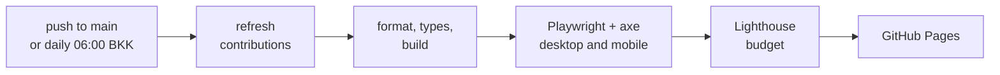

# layaungphyo.dev

The personal site of La Yaung Phyo (Freddie), a backend and systems engineer in Bangkok.
It is a single static page styled as a terminal session, built from the "Terminal · Latte" design in Figma.

## Stack

- [Astro](https://astro.build) 7, static output, TypeScript in strict mode.
- Plain CSS with design tokens taken from the Figma "Color" variables (mode "Terminal Latte").
- JetBrains Mono (official release, subset), Geist and Geist Mono, all self-hosted through the Astro Fonts API.
- About 5 KB of client JavaScript for the command palette, keyboard shortcuts, the live clock and the tmux bar.
- Playwright and axe for end-to-end and accessibility tests, Lighthouse CI for a performance budget.
- GitHub Actions builds, tests and deploys to GitHub Pages, and rebuilds daily to refresh the contribution heatmap.

## Commands

Run everything from the project root with Node 22 (see `.nvmrc`) and pnpm 10.

| Command                   | What it does                                                      |
| :------------------------ | :---------------------------------------------------------------- |
| `pnpm install`            | Install dependencies.                                             |
| `pnpm dev`                | Start the dev server on `localhost:4321`.                         |
| `pnpm build`              | Build the site into `dist/`.                                      |
| `pnpm preview`            | Serve `dist/` locally.                                            |
| `pnpm check`              | Type-check Astro and TypeScript files.                            |
| `pnpm test:e2e`           | Run Playwright on desktop and mobile against the built site.      |
| `pnpm format`             | Format TypeScript, CSS, Markdown and JSON with Prettier.          |
| `pnpm data:contributions` | Refresh `src/data/contributions.json` (needs `GH_CONTRIB_TOKEN`). |

Playwright needs a browser once: `pnpm exec playwright install chromium`.
The tests use the production build, so run `pnpm build` first.

To run the Lighthouse budget locally, point it at a Chrome binary:

```bash
CHROME_PATH=/path/to/chrome pnpm dlx @lhci/cli@0.15.1 autorun
```

Inside WSL, Chrome's launcher assumes Windows Chrome and leaves folders named like `C:\Users\…\lighthouse.XXXX` in the project.
They are throwaway browser profiles and safe to delete; CI does not have this problem.

## Layout

```text
src/
├── components/        sections (Hero, Work, About, Now, Contact) and their parts
│   └── plates/        the floodwatch and CineBook illustrations
├── content/projects/  one Markdown file per project
├── data/              site facts, profile, Now entries, diagrams, portrait, contributions
├── lib/               ASCII rendering, heatmap layout, clock, small helpers
├── scripts/site.ts    the only client script
├── styles/            tokens.css and global.css
└── pages/             index.astro and 404.astro
scripts/fetch-contributions.mjs   refreshes the heatmap data
tests/home.spec.ts                end-to-end and accessibility tests
```

## Editing content

Projects live in `src/content/projects/*.md`.
The frontmatter is validated by `src/content.config.ts`, and the Markdown body is the description shown in the open accordion row.
`order` sets the position, `open: true` opens a row by default, and `media` picks either a plate (`floodwatch`, `cinebook`) or an ASCII diagram from `src/data/diagrams.ts`.

The Now section reads `src/data/now.ts`.
Its short hashes are derived from each entry's text, so they stay stable between builds.
The `branch` field says where the side lane of the git graph leaves and rejoins the main lane.

Names, links and the email address are in `src/data/site.ts`, and the neofetch spec and principles are in `src/data/profile.ts`.

### Placeholders to replace before launch

- `site.linkedin.url` is `null`, so the LinkedIn row renders as plain text until a URL is set.
- `public/freddie-resume.pdf` does not exist yet, and every résumé link points there.
- `hello@layaungphyo.dev` only receives mail once forwarding is set up at Name.com.
- The Telegram message and backtest numbers in the floodwatch plate are illustrative.

## How the terminal look is built

Whitespace is part of the design, so a few rules keep it intact.

- Astro's `compressHTML` is set to `true`, because the Astro 7 default (`'jsx'`) removes spaces between inline elements.
- Deliberate runs of spaces go through `nb()` in `src/lib/text.ts`, which turns them into no-break spaces.
- Prettier does not format `.astro` files: its Astro plugin moves inline elements onto separate lines, which adds visible spaces.

The banner, the portrait and the diagrams are SVG, generated at build time by `src/lib/ascii.ts`.
As plain text, the █ blocks showed anti-aliased seams on fractional pixels, and some browsers round small glyph advances so the art grew wider than its box.

The accent and green are a shade deeper than in Figma (`#7c2fe0` and `#2a7019` instead of `#8839ef` and `#2f7d1f`).
That keeps small text at 4.5:1 or better on the tinted panels as well as on the page background.

The JetBrains Mono files in `src/assets/fonts` are subsets of the official 2.304 release, keeping ligatures.
To regenerate them with fontTools:

```bash
pyftsubset JetBrainsMono-Regular.woff2 --flavor=woff2 --layout-features='*' \
  --unicodes='U+0020-007E,U+00A0-00FF,U+2010-2027,U+2032-2033,U+2190-21FF,U+2212,U+2261,U+2318,U+2500-259F,U+25A0-25FF,U+2713-2717'
```

The font license is in `src/assets/fonts/OFL.txt`.

## Deployment



Pull requests run every step except the deploy.
If the contribution refresh fails, the build keeps the committed snapshot and logs a warning.

### One-time setup

1. Create the GitHub repository and push `main`.
2. In the repository, open Settings, then Pages, and set the source to GitHub Actions.
3. Add a repository secret named `GH_CONTRIB_TOKEN`: a fine-grained personal access token with read-only access to public repositories.
   It only reads the public contribution calendar.
4. Verify the domain under your account settings, in Pages, so nobody else can point it at their own site.
   GitHub shows a TXT record to add at Name.com.
5. Add these DNS records at Name.com, leaving the email forwarding records alone:

   | Type  | Host    | Answer                                                                                                       |
   | :---- | :------ | :----------------------------------------------------------------------------------------------------------- |
   | A     | (empty) | `185.199.108.153`, `185.199.109.153`, `185.199.110.153`, `185.199.111.153` (one record each)                 |
   | AAAA  | (empty) | `2606:50c0:8000::153`, `2606:50c0:8001::153`, `2606:50c0:8002::153`, `2606:50c0:8003::153` (one record each) |
   | CNAME | `www`   | `freddietheobserver.github.io`                                                                               |

6. In the repository's Pages settings, set the custom domain to `layaungphyo.dev` and enable "Enforce HTTPS" once the certificate is issued.

GitHub disables scheduled workflows in repositories with no activity for 60 days, so the daily refresh stops until the next push.
